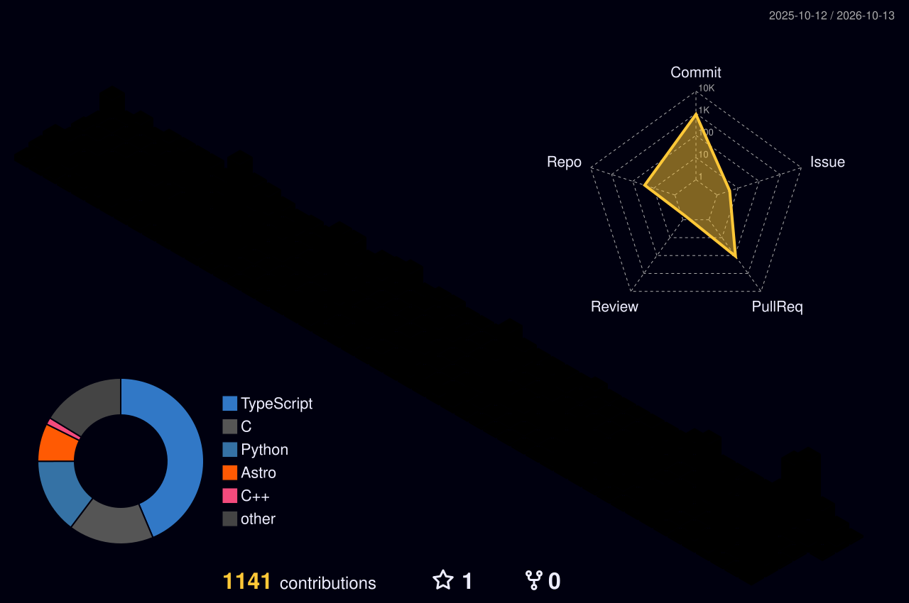

  

  <picture>
    <source media="(prefers-color-scheme: dark)" srcset="./profile-3d-contrib/profile-night-rainbow.svg">
    <source media="(prefers-color-scheme: light)" srcset="./profile-3d-contrib/profile-green-animate.svg">
    
  </picture>

  <picture>
    <source media="(prefers-color-scheme: dark)" srcset="https://raw.githubusercontent.com/Juna1013/Juna1013/output/github-contribution-grid-snake-dark.svg">
    <source media="(prefers-color-scheme: light)" srcset="https://raw.githubusercontent.com/Juna1013/Juna1013/output/github-contribution-grid-snake.svg">
    
  </picture>

## 💫 About me
- 👤 Name: Juna1013
- 🧬 Gender: He/Him
- 🌏 Location: Ibaraki, Japan
- 🧑‍💻 Professional: Learning, Algorithm, Mathemathics
- 🎨 Hobbies: Music, Pazle, Art
- ☁️ One liner: "Don't forget death."

## 🛠️ Tech Stack

### 💻 Languages

  
  
  
  

### 📚 Framework & Tools

  
  
  
  
  
  

## 🗒️ Work Priducts & Achievements

- 2025.05.10：DCON2025に本選出場（95チーム中5位、TOPY工業賞、日立産業制御ソリューションズ賞、Quick賞）
- 2025.08.18：茨城県警サイバーセキュリティボランティア委嘱
- 2025.09.01 - 09.05：EPSON サマーインターンに参加
- 2025.11.26：第5回 得意技・先進技術交流会に参加
- 2025.11.28：第8回CTF神奈川 6位（60人中）
- 2026.09.19：技育博2026 vol.2 に参加
- 2026.09.24：G検定を取得

## 🏆 Certifications

- 🥇 **TOEIC L&R**: 690
